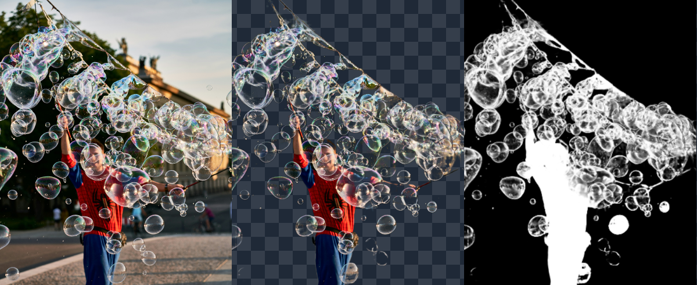

# withoutbg-comfyui

ComfyUI node for [withoutBG](https://withoutbg.com?utm_source=github&utm_medium=readme&utm_campaign=open-weights-v4&utm_content=withoutbg-comfyui-home) background removal. Run the open weights model locally (free) or opt in to Pro through the Cloud API.


## See the results

| | | |
|---|---|---|
|  |  |  |

## Install

**ComfyUI-Manager** (after the first registry release): search `withoutBG`.

**comfy-cli** (after the first registry release): `comfy node install withoutbg-comfyui`.

**Manual** (with [uv](https://docs.astral.sh/uv/)):

```bash
cd ComfyUI/custom_nodes
git clone https://github.com/withoutbg/withoutbg-comfyui
# into ComfyUI's venv (activate it first, or pass --python path/to/venv/bin/python)
uv pip install -r withoutbg-comfyui/requirements.txt
```

No uv? `pip install -r withoutbg-comfyui/requirements.txt` with ComfyUI's Python works too.

Restart ComfyUI. The node is under **image / withoutBG**.

## Node: withoutBG Remove Background

| Input | |
|---|---|
| `image` | IMAGE, any batch size |
| `engine` | `open_weights` (default, local, free) or `pro` (Cloud API) |

| Output | |
|---|---|
| `image` | RGBA. Original colours plus the matte as alpha. Save with **Save Image** for a transparent PNG |
| `mask` | The alpha matte, foreground = 1 |

An example workflow is in `example_workflows/`.

### Open weights

The first run downloads the model from Hugging Face (`withoutbg/withoutbg-openweights-onnx`) into the Hugging Face cache: 4 files, about 1.5 GB. The node shows a progress bar (one step per file) and prints each file in the ComfyUI console. ComfyUI otherwise looks idle until the download finishes. Later runs use the local copy and work offline.

To use files you downloaded yourself, set `WITHOUTBG_MODEL_PATH` to the `.onnx` file; the other bundle files must sit in the same folder. Runs on CPU.

### Pro (optional)

Pro is opt-in and needs an API key from your [account](https://withoutbg.com/account?utm_source=github&utm_medium=readme&utm_campaign=open-weights-v4&utm_content=withoutbg-comfyui-account). Each image costs 1 credit. Images are sent to the withoutBG API; open weights never leave your machine.

The key comes from the `WITHOUTBG_API_KEY` environment variable of the process that runs ComfyUI. The node has no key field on purpose: ComfyUI saves widget values in workflow files and embeds the workflow in every PNG it saves, so a pasted key would travel with anything you share.

Set the variable **before ComfyUI starts**. How depends on how you run it:

- **Comfy Desktop on macOS.** An app opened from the Dock or Finder does not see variables you `export` in a terminal. Quit it, then launch it from a terminal that has the key:

  ```bash
  export WITHOUTBG_API_KEY=...
  open --env WITHOUTBG_API_KEY="$WITHOUTBG_API_KEY" -a "Comfy Desktop"
  ```

  If the node still reports a missing key, start the app binary directly so it inherits the shell: `"/Applications/Comfy Desktop.app/Contents/MacOS/Comfy Desktop"`.
- **Comfy Desktop on Windows.** Set a user environment variable (for example `setx WITHOUTBG_API_KEY "..."` in a terminal), then quit and reopen the app.
- **Manual or portable install (any OS).** Export the variable in the same shell, then start ComfyUI (`python main.py`).

Avoid `launchctl setenv` on macOS: it exposes the key to every app until you reboot. If the key is missing, the node stops with a clear error before sending anything, so no credit is spent.

## Troubleshooting

- **OpenCV conflict:** `withoutbg` depends on `opencv-python-headless`. If ComfyUI already has `opencv-python`, the installer may add both. If `import cv2` breaks, reinstall one: `uv pip uninstall opencv-python opencv-python-headless && uv pip install opencv-python-headless` (or the same with `pip`, adding `-y` to uninstall).
- **Download fails with 401 or "Repository Not Found":** an expired Hugging Face login can cause this even though the model is public. Update `withoutbg` (`uv pip install -U withoutbg`) or run `hf auth logout`.
- **onnxruntime:** the package needs `onnxruntime`. Environments with `onnxruntime-gpu` keep working; the model still runs on CPU.

## Development

```bash
uv sync
uv run ruff check . && uv run ruff format --check .
uv run pytest
```

## License

Node code: Apache 2.0. Model: withoutBG Open Model License (Apache 2.0 for withoutBG portions; Meta DINOv3 License for DINOv3 backbone weights). **Built with DINOv3.** See `THIRD_PARTY_NOTICES.md`.

## Support

[Issues](https://github.com/withoutbg/withoutbg-comfyui/issues) · [withoutBG](https://withoutbg.com?utm_source=github&utm_medium=readme&utm_campaign=open-weights-v4&utm_content=withoutbg-comfyui-home)
