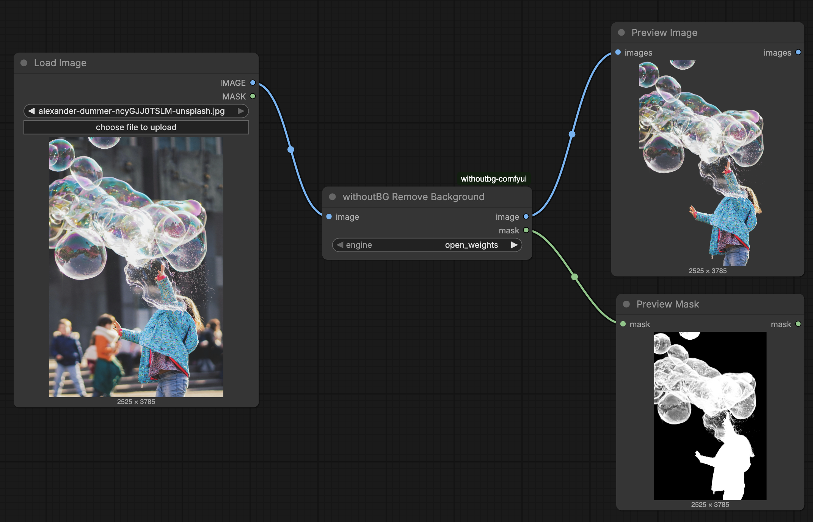
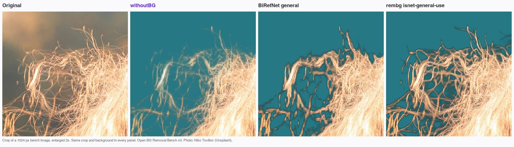
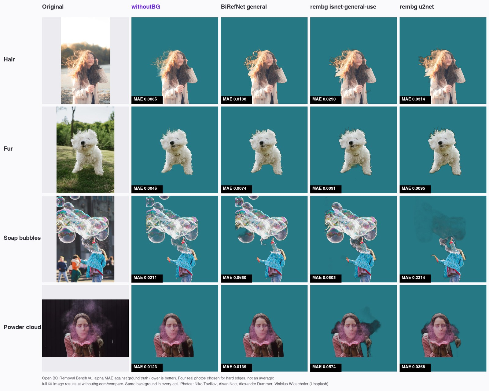

# withoutbg-comfyui

[](https://registry.comfy.org/publishers/withoutbg/nodes/withoutbg-comfyui)

ComfyUI node for [withoutBG](https://withoutbg.com?utm_source=github&utm_medium=readme&utm_campaign=open-weights-v4&utm_content=withoutbg-comfyui-home) background removal. Run the open weights model locally (free) or opt in to Pro through the Cloud API.




## See the results

Fine hair at 2x zoom, same crop and background in every panel. withoutBG keeps the thin strands translucent; the others turn them into dark, blotchy outlines.



Four real photos chosen for hard edges (hair, fur, soap bubbles, powder cloud), with the alpha MAE against ground truth printed on each cell (lower is better). The photos come from Open BG Removal Bench v0 (60 photos); these four are a selection, not an average. Full results: [withoutbg.com/compare](https://withoutbg.com/compare?utm_source=github&utm_medium=readme&utm_campaign=open-weights-v4&utm_content=withoutbg-comfyui-compare).



Photos: Niko Tsviliov, Alvan Nee, Alexander Dummer, Vinicius Wiesehofer, via Unsplash.

More examples (original, cutout, mask):

| | | |
|---|---|---|
|  |  |  |

## Why this node

Most background removers give a hard cut. withoutBG predicts a soft alpha matte, so hair, glass, smoke and soap bubbles keep their partial transparency and sit naturally on a new background. The open weights run on your machine (CPU, or an NVIDIA GPU when available), nothing is uploaded, and there is no per-image cost. Pro (Cloud API) is optional.

See how it compares on [the benchmark page](https://withoutbg.com/compare?utm_source=github&utm_medium=readme&utm_campaign=open-weights-v4&utm_content=withoutbg-comfyui-compare).

## Install

**ComfyUI-Manager**: search `withoutBG`.

**comfy-cli**: `comfy node install withoutbg-comfyui`

**Manual** (with [uv](https://docs.astral.sh/uv/)):

```bash
cd ComfyUI/custom_nodes
git clone https://github.com/withoutbg/withoutbg-comfyui
# into ComfyUI's venv (activate it first, or pass --python path/to/venv/bin/python)
uv pip install -r withoutbg-comfyui/requirements.txt
```

No uv? `pip install -r withoutbg-comfyui/requirements.txt` with ComfyUI's Python works too.

Restart ComfyUI. The node is under **image / withoutBG**.

## Example workflows

Open **Workflow → Browse Templates → withoutbg-comfyui**:

| Template | What it does |
|---|---|
| `remove_background` | Photo in, transparent PNG out, plus a mask preview |
| `replace_background` | Cut out a subject and composite it over a new background through the soft mask |
| `green_screen_video` | Cut out every frame of a clip onto solid green (or any colour) |

## Node: withoutBG Remove Background

| Input | |
|---|---|
| `image` | IMAGE, any batch size |
| `engine` | `open_weights` (default, local, free) or `pro` (Cloud API) |
| `device` | `auto` (default) uses an NVIDIA GPU when `onnxruntime-gpu` and `onnx` are installed (see GPU), else CPU. `cpu` forces CPU. Open weights only |
| `background` | `alpha` (default): RGBA with transparency. `white`, `black` or `color`: 3-channel RGB on a solid colour, for nodes that expect 3 channels (VAE Encode, upscalers) |
| `color` | Hex colour such as `#00FF00`, used when `background` is `color` |

| Output | |
|---|---|
| `image` | Original colours plus the matte as alpha (RGBA), or on a solid colour (RGB) when `background` is not `alpha`. Save RGBA with **Save Image** for a transparent PNG |
| `mask` | The alpha matte, foreground = 1 |

Workflows saved with version 0.1 keep working: the new inputs sit after `engine` and have defaults.

### Open weights

The first run downloads the model from Hugging Face (`withoutbg/withoutbg-openweights-onnx`) into the Hugging Face cache: 4 files, about 1.5 GB. The node shows a progress bar (one step per file) and prints each file in the ComfyUI console. ComfyUI otherwise looks idle until the download finishes. Later runs use the local copy and work offline.

### GPU

The default install runs on CPU. For an NVIDIA GPU, swap the ONNX Runtime package in ComfyUI's Python and add `onnx` (the node uses it to prepare the model for CUDA, nothing is written to disk):

```bash
uv pip uninstall onnxruntime && uv pip install onnxruntime-gpu onnx
```

Then `device = auto` uses the GPU. On an RTX 2070 SUPER, 12 mixed test photos averaged about 1.7 s on the GPU against about 6 s on CPU, with the alpha matching the CPU result to within 1/255.

When the GPU is used, the ComfyUI console prints `withoutBG: open weights running on CUDAExecutionProvider`. If the GPU fails at run time the node logs one warning and continues on CPU. Without the GPU packages the node runs on CPU as before.

To use files you downloaded yourself, set `WITHOUTBG_MODEL_PATH` to the `.onnx` file; the other bundle files must sit in the same folder.

### Pro (optional)

Pro is opt-in and needs an API key from your [account](https://withoutbg.com/account?utm_source=github&utm_medium=readme&utm_campaign=open-weights-v4&utm_content=withoutbg-comfyui-account). Each image costs 1 credit. Images are sent to the withoutBG API; open weights never leave your machine.

The key comes from the `WITHOUTBG_API_KEY` environment variable of the process that runs ComfyUI. The node has no key field on purpose: ComfyUI saves widget values in workflow files and embeds the workflow in every PNG it saves, so a pasted key would travel with anything you share.

Set the variable **before ComfyUI starts**. How depends on how you run it:

- **Comfy Desktop on macOS.** An app opened from the Dock or Finder does not see variables you `export` in a terminal. Quit it, then launch it from a terminal that has the key:

  ```bash
  export WITHOUTBG_API_KEY=...
  open --env WITHOUTBG_API_KEY="$WITHOUTBG_API_KEY" -a "Comfy Desktop"
  ```

  If the node still reports a missing key, start the app binary directly so it inherits the shell: `"/Applications/Comfy Desktop.app/Contents/MacOS/Comfy Desktop"`.
- **Comfy Desktop on Windows.** Set a user environment variable (for example `setx WITHOUTBG_API_KEY "..."` in a terminal), then quit and reopen the app.
- **Manual or portable install (any OS).** Export the variable in the same shell, then start ComfyUI (`python main.py`).

Avoid `launchctl setenv` on macOS: it exposes the key to every app until you reboot. If the key is missing, the node stops with a clear error before sending anything, so no credit is spent.

## Troubleshooting

- **OpenCV conflict:** `withoutbg` depends on `opencv-python-headless`. If ComfyUI already has `opencv-python`, the installer may add both. If `import cv2` breaks, reinstall one: `uv pip uninstall opencv-python opencv-python-headless && uv pip install opencv-python-headless` (or the same with `pip`, adding `-y` to uninstall).
- **Download fails with 401 or "Repository Not Found":** an expired Hugging Face login can cause this even though the model is public. Update `withoutbg` (`uv pip install -U withoutbg`) or run `hf auth logout`.
- **onnxruntime vs onnxruntime-gpu:** install only one of them in ComfyUI's Python. Having both can hide the GPU build; uninstall both, then install the one you want.
- **Not using the GPU:** run `python -c "import onnxruntime; print(onnxruntime.get_available_providers())"` in ComfyUI's Python. If `CUDAExecutionProvider` is missing, you have the CPU build.

## Development

```bash
uv sync
uv run ruff check . && uv run ruff format --check .
uv run pytest
```

## License

Node code: Apache 2.0. Model: withoutBG Open Model License (Apache 2.0 for withoutBG portions; Meta DINOv3 License for DINOv3 backbone weights). **Built with DINOv3.** See `THIRD_PARTY_NOTICES.md`.

## Support

[Issues](https://github.com/withoutbg/withoutbg-comfyui/issues) · [withoutBG](https://withoutbg.com?utm_source=github&utm_medium=readme&utm_campaign=open-weights-v4&utm_content=withoutbg-comfyui-home)
